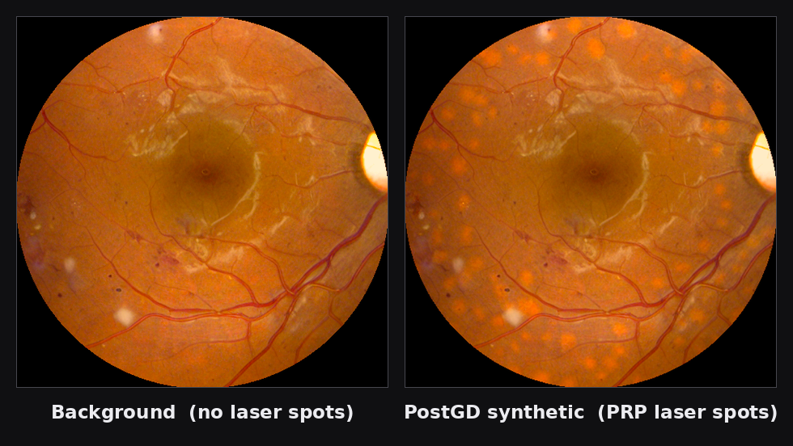
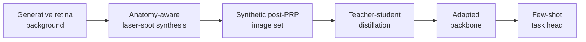
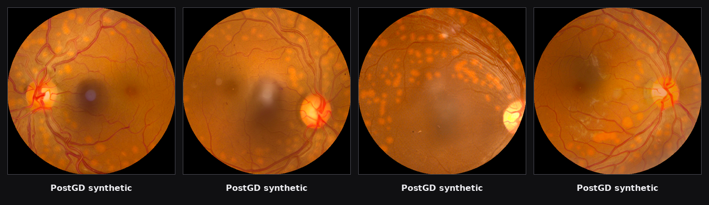

# PostGD

**Adapting vision foundation models to post-photocoagulation fundus images via synthetic data and distillation.**

[](LICENSE)
[](https://www.python.org/downloads/)
[](#disclaimer)



*Left: a retinal background from the generative background model. Right: the same background
after PostGD anatomy-aware laser-spot synthesis. Both panels are fully synthetic — no
patient data appears anywhere in this repository.*

## Overview

Pan-retinal photocoagulation (PRP) leaves a grid of laser scars across the retina.
Those scars change the appearance of a fundus photograph enough that models trained on
ordinary retinal images lose accuracy on post-treatment eyes — and labelled post-PRP
images are scarce.

PostGD closes that gap without collecting new clinical labels. It synthesises realistic
post-PRP fundus images from a generative retina background model, then distils the
representation of a frozen vision foundation model into a compact student backbone. The
adapted backbone can be specialised to a downstream task with only a handful of labelled
images.

## Contents

- [Pipeline](#pipeline)
- [Quick Start](#quick-start)
- [Features](#features)
- [Installation](#installation)
- [Pretrained models](#pretrained-models)
- [Usage](#usage)
- [Repository layout](#repository-layout)
- [Data and privacy](#data-and-privacy)
- [Citation](#citation)
- [Contributing](#contributing)
- [License](#license)

## Pipeline



| Stage | Purpose | Entry point |
|-------|---------|-------------|
| **1 — Generation** | Render PRP laser spots onto retinal backgrounds | [`stage1/`](stage1/) |
| **2 — Distillation** | Adapt a DINOv3 backbone to the synthetic domain | [`distillation/distill.py`](distillation/distill.py) |
| **3 — Adaptation** | Fit a light head on a few labelled images | [`downstream/adapt_head.py`](downstream/adapt_head.py), [`downstream/segmentation/few_shot_segmentation.py`](downstream/segmentation/few_shot_segmentation.py) |

More synthetic results from Stage 1:



## Quick Start

```bash
git clone https://github.com/Deliver0/PostGD.git
cd PostGD
pip install -r stage1/render_only/requirements.txt
```

Render a synthetic post-PRP image from any retinal background:

```bash
python stage1/render_only/render_spots.py \
  --input  /path/to/fundus_background.png \
  --output-dir ./output
```

The command writes a synthetic image, a spot mask, and a metadata file. To enable the
anatomy-aware path, point the renderer at the prior models first — see
[Pretrained models](#pretrained-models).

## Features

| Feature | What it gives you |
|---------|-------------------|
| **No clinical data needed** | The synthetic training set is generated from a public retina background model. |
| **Anatomy-aware placement** | Spots follow a PRP-style radial grid around the posterior pole and avoid vessels and the optic disc. |
| **Approved appearance profiles** | Solid and ring-shaped burn profiles ship with the generator; the default matches real post-operative fundus images. |
| **Reproducible by construction** | Every generated image carries a metadata record of the requested and actual spot count. |
| **Compact distilled student** | The adapted backbone is a ViT-B/16, small enough to fine-tune with a few labelled images. |
| **Leak-free evaluation** | Both downstream adapters select their head on support data only; query labels are read after the model is locked. |

## Installation

The three stages have different runtime requirements and are best kept in separate
environments. The released scripts target Python 3.10/3.11 with a CUDA-enabled PyTorch;
select the matching wheel from the official PyTorch index for your machine.

| Stage | Requirements file |
|-------|-------------------|
| Stage 1 — standalone renderer | `stage1/render_only/requirements.txt` |
| Stage 1 — full generator | `stage1/full_method/requirements.txt` |
| Stage 2 — distillation | `distillation/requirements.txt` |
| Stage 3 — classification head | `distillation/requirements.txt` |
| Stage 3 — segmentation head | `downstream/segmentation/requirements.txt` |

## Pretrained models

No checkpoint is committed to this repository. The download links, directory layout,
checksums and licence notes for every component — the retina background model, the
vessel and fovea/optic-disc priors, the DINOv3 initialisation, and the PostGD student —
are collected in [`docs/MODEL_WEIGHTS.md`](docs/MODEL_WEIGHTS.md).

The scripts expect them under a local, ignored `models/` directory:

```text
models/
├── stable-diffusion-v1-4/     CompVis base components
├── sd-retina-model/           ReSDv1.4 fine-tuned UNet (retina background model)
├── wnet_drive/                vessel segmentation checkpoint
├── fovea_od/                  fovea / optic-disc localisation checkpoint
└── dinov3/                    DINOv3 initialisation weights
```

Third-party components keep their own licences. Review
[`docs/THIRD_PARTY.md`](docs/THIRD_PARTY.md) before redistributing anything.

## Usage

### Stage 1 — synthetic image generation

The full generator produces backgrounds, calibrates colour on the field of view, places
spots subject to anatomical avoidance, and exports a dataset together with a per-image
manifest:

```bash
python stage1/full_method/generate.py \
  --count 20000 \
  --output-size 224 \
  --device cuda \
  --output-dir /path/to/runs/stage1_20k
```

Two approved spot profiles ship with the generator — `bright_no_dark` (the default solid
appearance) and `dark_center`. Switch between them with `--spot-case`, and pass
`--no-prior` for a geometry-only smoke test that skips the anatomy models.

The requested spot count is an **upper bound, not a target**: field-of-view limits,
anatomical avoidance and inter-spot spacing all take priority, and the number of spots
actually burned is recorded in the metadata and manifest.

### Stage 2 — teacher–student distillation

```bash
python distillation/distill.py \
  --data-dir /path/to/runs/stage1_20k/distill_224 \
  --output-dir /path/to/runs/distill_20k \
  --teacher-model vit_large_patch16_dinov3 \
  --student-model vit_base_patch16_dinov3 \
  --teacher-weights /path/to/weights/dinov3 \
  --student-weights /path/to/weights/dinov3 \
  --epochs 200 \
  --expected-images 20000 \
  --device cuda
```

The teacher is frozen; the student and a feature projector are optimised with an MSE
distillation loss plus a view-consistency term. Both models start from **pretrained**
DINOv3 weights — a randomly initialised student collapses under this objective. Training
writes `config.json`, per-epoch metrics, the final student and the projection head. The
full objective and hyperparameters are in
[`docs/IMPLEMENTATION.md`](docs/IMPLEMENTATION.md).

### Stage 3 — few-shot downstream adaptation

The adapters are dataset-agnostic: they consume frozen backbone features and a
support/query split, select a head using **support labels only**, and report on the
held-out query set.

Classification head:

```bash
python downstream/adapt_head.py \
  --support-npz /path/to/support_and_query.npz \
  --output /path/to/runs/downstream_result.json
```

See [`downstream/README.md`](downstream/README.md) for the NPZ format.

Segmentation head — it reads images and masks from a JSON manifest, caches the frozen
pyramid features once, and fits a small decoder:

```bash
python downstream/segmentation/few_shot_segmentation.py \
  --manifest /path/to/dataset/manifest.json \
  --student-weights /path/to/student_final.pth \
  --backbone vit_base_patch16_dinov3 \
  --image-size 1024 \
  --output /path/to/runs/seg_result
```

For each task the decoder's epoch count and binarisation threshold are chosen by
support-only leave-one-out cross-validation, and the query split is scored once,
after the decoder is locked. Each run writes `summary.json` with the selected
settings, the query metrics and a provenance block (backbone, student SHA-256,
manifest SHA-256, every hyper-parameter, `torch`/`python` versions) plus
`test_metrics.jsonl` for per-image audit. Checkpoints trained at a resolution other
than 224 need `--model-kwargs '{"img_size": 1024}'`. Full details in
[`downstream/segmentation/README.md`](downstream/segmentation/README.md).

## Repository layout

```text
PostGD/
├── stage1/                Synthetic image generation
│   ├── full_method/       Background → calibrated, spot-rendered images
│   └── render_only/       Render spots on an existing fundus background
├── distillation/          Teacher–student representation learning
├── downstream/            Few-shot head adaptation (classification + segmentation)
├── configs/               Public Lab-profile template
└── docs/                  Implementation, weights, reproducibility, licensing
```

## Data and privacy

Clinical images, derived hospital statistics, model checkpoints and generated datasets
are **not** included in this repository and never will be. Fit colour profiles on your own
training reference set only, and confirm you hold the required data-use permissions before
running on clinical data.

<a id="disclaimer"></a>

> **Disclaimer.** This is research code, not a medical device. It must not be used for
> diagnosis or treatment decisions.

## Citation

See [`CITATION.bib`](CITATION.bib).

## Contributing

Issues and pull requests are welcome. Please keep changes small and focused, and describe
the exact command and configuration you used so results stay reproducible. Questions about
setup or reproduction are best raised as a GitHub issue, where the answer stays visible to
everyone.

## License

The original method code in this repository is released under the [MIT License](LICENSE).
Third-party packages, checkpoints and prior-model implementations retain their own
licences and terms.
