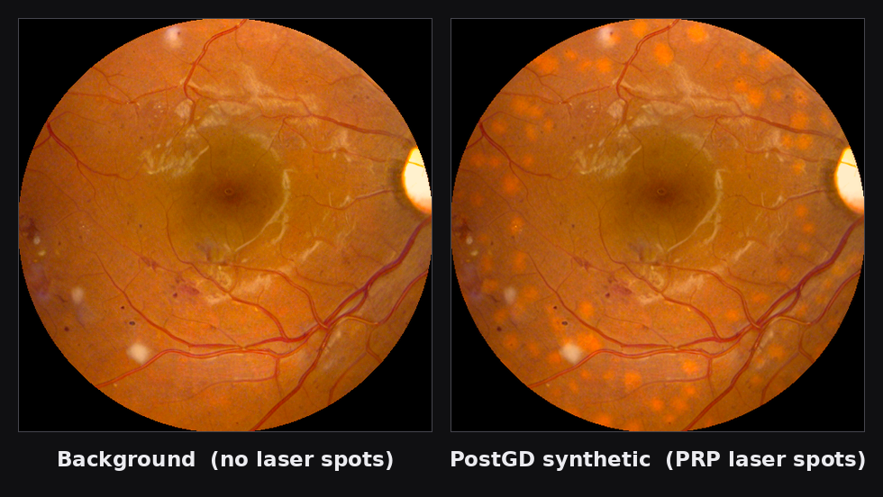
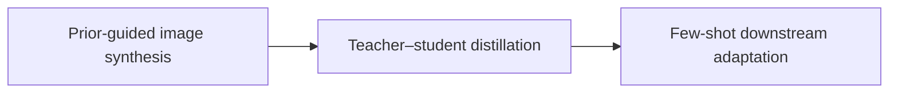
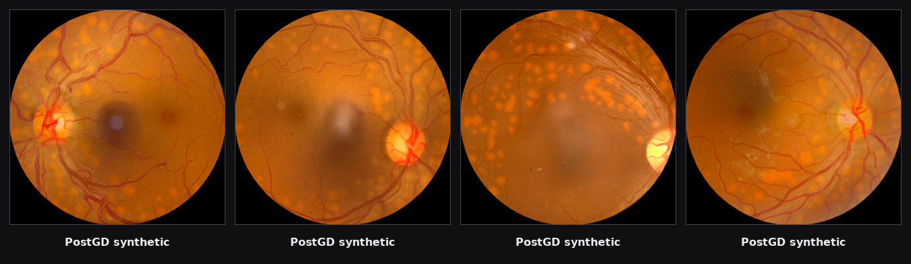

# PostGD

**A Generation–Distillation Foundation Model for Post-Photocoagulation Fundus Images**

[](LICENSE)
[](https://www.python.org/downloads/)



*A generated retinal background (left) and its postoperative simulation (right). Both images are synthetic.*

## What is PostGD?

PostGD learns representations for postoperative fundus analysis when annotated
images are scarce. It combines anatomically guided laser-scar synthesis with
distillation from a frozen DINOv3 ViT-L teacher to a ViT-B student. The student
then supports multiple downstream tasks with a small set of real annotated images.



- **Generation:** synthesize postoperative images and laser masks for PRP or macular GRID photocoagulation.
- **Segmentation:** laser scars, retinal vessels, optic disc and optic cup.
- **Classification and localization:** laser-scar presence, optic-disc centre and foveal centre.

<details>
<summary>More synthetic examples</summary>



</details>

## Quick start: render an image

Use Python 3.10 or 3.11. Clone the repository and install the renderer dependencies:

```bash
git clone https://github.com/Deliver0/PostGD.git
cd PostGD
pip install -r stage1/render_only/requirements.txt

python stage1/render_only/render_spots.py \
  --input /path/to/fundus_background.png \
  --output-dir ./output \
  --no-prior
```

This geometry-only demo writes a synthetic image, a laser mask and metadata.
For anatomy-guided placement, configure the vessel and fovea/optic-disc models
following the [generation guide](stage1/full_method/README.md). PRP is the default;
use `--treatment grid` for GRID with anatomical priors enabled.

## Train and use PostGD

Choose the stage you need. Each guide includes installation, model setup and
commands; separate environments are recommended for generation and training.

| Goal | Entry point | Guide |
| --- | --- | --- |
| Generate an image–mask dataset | [`stage1/full_method/generate.py`](stage1/full_method/generate.py) | [Generation](stage1/full_method/README.md) |
| Distil the student backbone | [`distillation/distill.py`](distillation/distill.py) | [Setup and training command](docs/MODEL_WEIGHTS.md#5-dinov3-initialization) |
| Train segmentation heads | [`few_shot_segmentation.py`](downstream/segmentation/few_shot_segmentation.py) | [Segmentation](downstream/segmentation/README.md) |
| Train a classification head | [`extract_features.py`](downstream/extract_features.py) → [`adapt_head.py`](downstream/adapt_head.py) | [Classification](downstream/README.md#classification) |
| Train landmark localization heads | [`few_shot_localization.py`](downstream/localization/few_shot_localization.py) | [Localization](downstream/localization/README.md) |

For example, adapt a student checkpoint to segmentation tasks using your image/mask manifest:

```bash
pip install -r downstream/segmentation/requirements.txt

python downstream/segmentation/few_shot_segmentation.py \
  --manifest /path/to/manifest.json \
  --student-weights /path/to/student_final.pth \
  --image-size 224 \
  --output ./runs/segmentation
```

## Models and data

Download the pretrained **PostGD student** from
[Hugging Face](https://huggingface.co/Deliver0/postgd-dinov3-student):

```bash
hf download Deliver0/postgd-dinov3-student student_final.pth --local-dir models/student
```

Use `models/student/student_final.pth` with `--student-weights` in the downstream
scripts. The model page also provides direct `timm` loading, the model card and
weight license. Task-specific heads require separate training.

[Model setup and download links](docs/MODEL_WEIGHTS.md) cover the background
generator, anatomical priors and DINOv3 initialization. Clinical datasets and
weight files are not bundled in this Git repository.

For further details, see the [implementation notes](docs/IMPLEMENTATION.md) and
[reproducibility checklist](docs/REPRODUCIBILITY.md).

## Citation and license

Please cite PostGD using [`CITATION.bib`](CITATION.bib).
Original code is released under the [MIT License](LICENSE); external models retain
their [own licenses](docs/THIRD_PARTY.md).

This repository is intended for research use.
